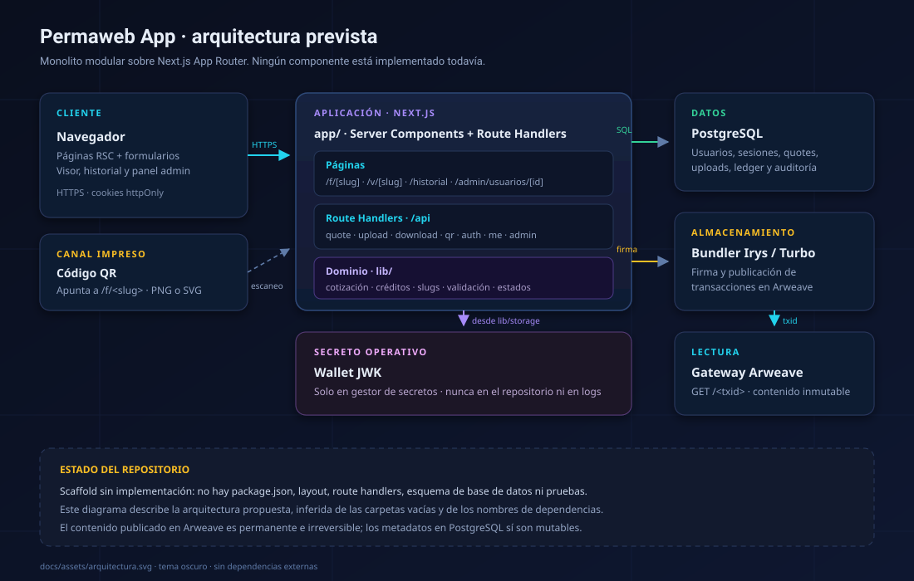
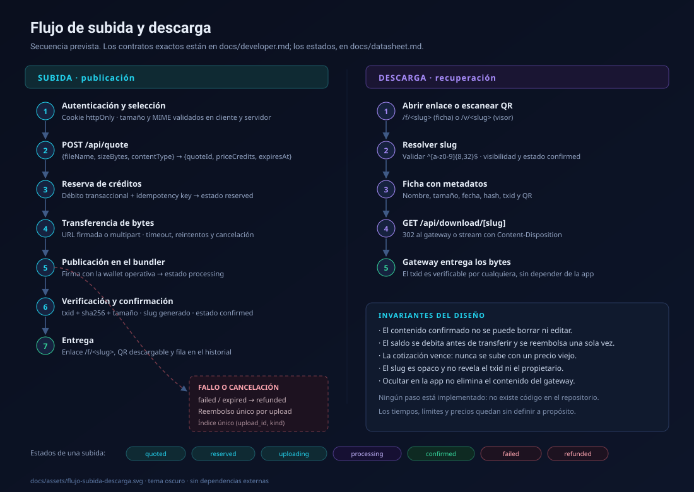
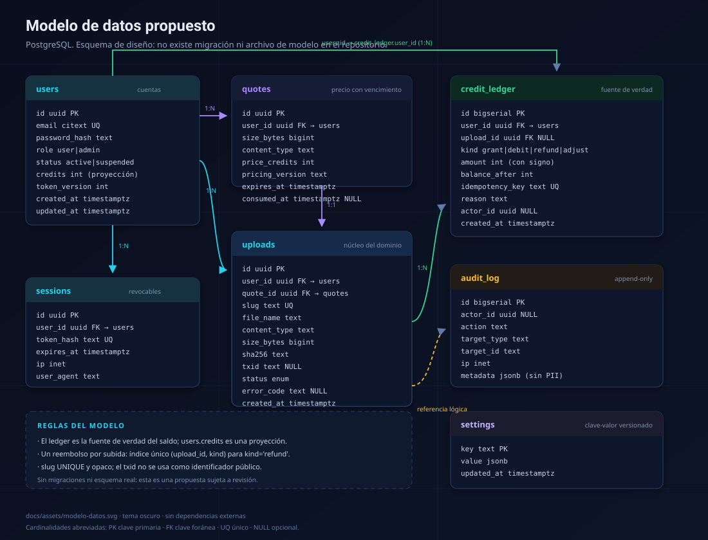

<div align="center">

# PermaDrop · Permaweb App

**Publicación y almacenamiento permanente de archivos, con enlaces cortos, código QR y panel de administración.**

Diseño de una aplicación web sobre **Next.js (App Router) + TypeScript**, con metadatos en **PostgreSQL** y contenido almacenado de forma **permanente en Arweave**.

 

</div>

> [!NOTE]
> **Este README es el documento de diseño; la implementación existe y se materializó durante su redacción.**
> El análisis comenzó con un scaffold vacío (0 archivos). Mientras se documentaba, la carpeta recibió la aplicación **PermaDrop** (Next.js 16.4.3 + React 19 + PostgreSQL + Arweave): 79 archivos, `package.json`, `db/schema.sql`, `app/`, `components/`, `lib/` y `scripts/`.
> El **estado verificado del código** —funciones terminadas, seguridad aplicada y límites— está en [`ESTADO-PROYECTO.md`](ESTADO-PROYECTO.md). Este documento describe la arquitectura y el producto de referencia; **donde el código y este texto difieran, prevalece el código**.

## Índice

1. [Estado real](#1-estado-real-del-proyecto) · 2. [Qué es](#2-qué-es-y-qué-problema-resuelve) · 3. [Qué no es](#3-qué-no-es-este-repositorio) · 4. [Funcionamiento](#4-principio-de-funcionamiento) · 5. [Arquitectura](#5-arquitectura-prevista) · 6. [Rutas](#6-mapa-de-rutas) · 7. [Flujos](#7-flujos-principales) · 8. [Stack](#8-stack-previsto-y-evidencia-disponible) · 9. [Datos](#9-modelo-de-datos-resumen) · 10. [Operar](#10-forma-de-operar) · 11. [Puesta en marcha](#11-requisitos-y-puesta-en-marcha) · 12. [Conexiones](#12-mapa-de-conexiones-y-puertos) · 13. [Entorno](#13-variables-de-entorno-previstas) · 14. [Calibración](#14-calibración-y-ajuste-de-parámetros) · 15. [Seguridad](#15-seguridad-advertencias-y-precauciones) · 16. [Límites](#16-límites-supuestos-y-decisiones-abiertas) · 17. [Estructura](#17-estructura-del-repositorio) · 18. [Roadmap](#18-roadmap) · 19. [Documentación](#19-documentación) · 20. [Licencia](#20-licencia)

---

## 1. Punto de partida y estado

El análisis comenzó con un **scaffold vacío**: una maqueta de directorios para fijar la forma del proyecto antes de escribir código. La verificación inicial fue contundente:

| Comprobación | Resultado |
|---|---|
| Archivos de código (`*.ts`, `*.tsx`, `*.js`, `*.css`, `*.sql`) | **0** |
| `package.json`, `package-lock.json`, `tsconfig.json`, `next.config.*` | **No existen** |
| `README.md`, `LICENSE`, `.gitignore` | **No existían** (se crean con esta documentación) |
| Esquema de base de datos, migraciones y pruebas | **No existen** |
| Contenido de `node_modules/` | **85 paquetes, todos vacíos: 0 archivos** |

Los directorios de `node_modules/` conservan los **nombres** de las dependencias esperadas y su árbol de carpetas, pero fueron vaciados: son una **pista de diseño**, no una instalación utilizable. `npm install` no puede funcionar (no hay manifiesto), `npm run dev` no existe (no hay scripts) y no hay URL, pantalla ni endpoint que abrir. El valor del repositorio es **documental y de planificación**.

**Actualización:** durante la redacción, la carpeta recibió la implementación **PermaDrop** (79 archivos; `package.json` con Next 16.4.3, React 19.3.1, `pg`, `arweave`, `jose` y `qrcode`; `db/schema.sql`; `app/`, `components/`, `lib/`, `scripts/`; `node_modules` instalado con 778 archivos). El estado funcional verificado se documenta en [`ESTADO-PROYECTO.md`](ESTADO-PROYECTO.md) y este README no lo duplica. Lo que sigue describe el diseño de referencia y las decisiones que el código resolvió por su cuenta.

---

## 2. Qué es y qué problema resuelve

**Permaweb App** (nombre de trabajo; el repositorio no declara nombre comercial) es el diseño de un servicio web para **publicar archivos de forma permanente** y compartirlos con un enlace corto y un código QR.

El término *permaweb* alude a la web permanente: contenido en una red descentralizada (Arweave) que, una vez confirmado, **no se puede borrar ni modificar** y sigue siendo recuperable por HTTP vía gateways. La aplicación envuelve esa capacidad con lo que un usuario común necesita: cuenta y saldo de créditos, cotización previa, subida guiada, enlace corto (`/f/<slug>`), QR imprimible, página de descarga, historial y panel de administración.

### 2.1. El problema

Publicar en Arweave "a mano" exige entender wallets, tarifas por byte, transacciones, bundlers y gateways. Para un usuario no técnico —un fotógrafo con un portafolio, una organización que necesita un comprobante inmutable, una pyme que archiva contratos— esa barrera es demasiado alta. La propuesta es **una capa de producto sobre la red**: el usuario paga en créditos, sube un archivo, recibe enlace y QR, y el sistema se encarga del resto.

---

## 3. Qué NO es este repositorio

- **No es el manual de la implementación**: documenta el diseño de referencia; el estado del código está en `ESTADO-PROYECTO.md`.
- **No incluye contratos inteligentes** propios: se apoya en un bundler de terceros (Irys/Turbo).
- **No incluye pasarela de pago:** hay créditos y rutas admin para otorgarlos, pero la compra con dinero real es una **decisión abierta** (§16).
- **No promete métricas:** sin benchmarks, SLA ni tiempos de respuesta; no se inventan.
- **No contiene credenciales, claves ni direcciones de wallet** (ver `.gitignore`).

---

## 4. Principio de funcionamiento

### 4.1. Dos capas: contenido y metadatos

| Capa | Qué guarda | Dónde | Mutabilidad |
|---|---|---|---|
| **Contenido** | Los bytes del archivo | Arweave (vía bundler) | **Inmutable y permanente** |
| **Metadatos** | Slug, propietario, nombre, MIME, tamaño, hash, txid, estado, contadores | PostgreSQL | Mutable (estado, visibilidad, contadores) |

Es la decisión central: permite índices rápidos, paginación y control de acceso **sin** depender de un gateway, y garantiza que el archivo no dependa de la base: si el servidor desapareciera, el contenido seguiría recuperable con el `txid`.

### 4.2. Por qué Arweave

Arweave cobra **una vez, por adelantado**, y financia un *endowment* que remunera el almacenamiento a perpetuidad. El contenido se identifica por el hash de la transacción (`txid`) y se recupera por HTTP vía gateways (`https://<gateway>/<txid>`). Encaja con el producto: pagar una vez por publicar algo para siempre.

| Alternativa | Ventaja | Motivo para no usarla como base |
|---|---|---|
| **Arweave + Irys** | Pago en AR/tokens, API simple | Dependencia del bundler |
| **Arweave + Turbo** | Pago con tarjeta/tokens, SDK TS | Dependencia y comisiones |
| **Arweave directo** | Sin intermediarios | Firmar/financiar transacciones; peor UX |
| **IPFS + pinning** | Ecosistema amplio, barato | El pinning es contractual, no permanencia criptoeconómica |

La elección **no está cerrada**: el scaffold sugiere Arweave (`arweave`, `arconnect`, `@ardrive`), pero no hay configuración que confirme el proveedor.

### 4.3. El rol del bundler

Un *bundler* agrupa muchas subidas en una transacción de Arweave, abaratando costos y simplificando el pago. La aplicación **no** firma en el navegador: el servidor conserva la wallet operativa en un gestor de secretos y paga el almacenamiento; el usuario paga en **créditos internos**. Así la experiencia es simple y no se exponen claves.

```
bytes ──► bundler (firma + pago) ──► Arweave (txid) ──► gateway (HTTP)
             ▲
             └── servidor (wallet operativa, saldo, política de precios)
```

### 4.4. Direccionamiento: slug vs txid

El `txid` es largo y no memorizable. El producto usa un **slug** corto, opaco y aleatorio (10–16 caracteres base62) resuelto en la base hacia el `txid`: enlaces aptos para QR de baja densidad, presentación modificable sin tocar el contenido, y sin revelar orden de creación ni propietario. El slug **no** es seguridad: es no adivinable, pero cualquiera con el enlace accede si la subida es pública.

### 4.5. Cotización antes de subir

```
costo_creditos = techo(bytes / 1_000_000) * tarifa_por_MB * (1 + margen) + cargo_fijo
```

Los parámetros **no tienen valores definidos** aquí: deben vivir en configuración (`settings` o variables de entorno) y quedar versionados para auditar cotizaciones históricas. La cotización se firma y vence, para que la subida no pueda pagar un precio viejo.

---

## 5. Arquitectura prevista



*Diagrama: `docs/assets/arquitectura.svg` (tema oscuro, sin dependencias externas).*

| Componente | Responsabilidad | Ubicación prevista |
|---|---|---|
| **Cliente web** | Render, formularios, visor, QR | `app/`, `components/` |
| **Route Handlers** | API JSON: quote, upload, download, qr, auth, admin | `app/api/**/route.ts` |
| **Dominio** | Cotización, créditos, slugs, validación, estados | `lib/` |
| **Datos** | Consultas, transacciones, migraciones | `db/`, `lib/db` |
| **Almacenamiento** | Firma y publicación en Arweave | `lib/storage` (previsto) |
| **PostgreSQL** | Metadatos, usuarios, ledger, auditoría | Servicio externo |
| **Arweave + gateway** | Contenido permanente y recuperación HTTP | Servicio externo |

**Estilo:** monolito modular sobre App Router, *server-first* (las páginas leen de la base en el servidor; el cliente se reserva para interacción), route handlers con contratos JSON estables y validación en el borde, y separación estricta entre ruta y lógica de negocio (la ruta llama a `lib/`). No hay microservicios: el volumen esperado no los justifica.

**Por qué App Router:** la estructura ya está organizada así (`app/api/.../route.ts`, segmentos `[slug]`). Se asume Next.js 14+ con React Server Components; el Pages Router obligaría a rehacerla sin ventajas.

---

## 6. Mapa de rutas

Inventario **completo** de rutas reservadas. Todas existen como carpetas vacías: **ninguna** tiene archivo.

### 6.1. Páginas (UI)

| Ruta | Archivo previsto | Propósito (inferido) |
|---|---|---|
| `/f/[slug]` | `app/f/[slug]/page.tsx` | **Ficha** pública: nombre, tamaño, fecha, hash, descarga, QR |
| `/v/[slug]` | `app/v/[slug]/page.tsx` | **Visor** en línea (imagen, PDF, texto, audio, video) |
| `/historial` | `app/historial/page.tsx` | Historial de subidas del usuario |
| `/admin/usuarios` | `app/admin/usuarios/page.tsx` | Listado de usuarios, saldo, estado |
| `/admin/usuarios/[id]` | `app/admin/usuarios/[id]/page.tsx` | Detalle: datos, subidas, movimientos, acciones |

> **Nota:** el scaffold distingue `/f/[slug]` y `/v/[slug]` sin documentar la diferencia. Hipótesis de trabajo: **ficha** vs **visor**. Es la decisión abierta A-03 (§16).

### 6.2. API (Route Handlers)

| Método (previsto) | Ruta | Propósito | Auth |
|---|---|---|---|
| `POST` | `/api/quote` | Cotizar una subida | Usuario |
| `GET` | `/api/quote` | Tarifas vigentes | Pública |
| `POST` | `/api/upload` | Iniciar subida (o subir, según variante) | Usuario |
| `GET` | `/api/upload?id=` | Estado de subida (no hay `[id]`) | Usuario |
| `GET` | `/api/download/[slug]` | Descarga (redirect o stream) | Pública |
| `GET` | `/api/qr/[slug]` | PNG/SVG del QR | Pública |
| `POST` | `/api/auth/register`, `.../login` | Alta e inicio de sesión | Pública |
| `POST` | `/api/auth/logout` | Cierre de sesión | Usuario |
| `GET` | `/api/me` | Perfil, saldo, contadores | Usuario |
| `GET` | `/api/admin/uploads`, `.../[id]` | Listado y detalle de subidas | Admin |
| `POST` | `/api/admin/uploads/[id]/refund` | Reembolsar subida fallida | Admin |
| `GET` | `/api/admin/users`, `.../[id]` | Listado y detalle de usuarios | Admin |
| `POST` | `/api/admin/users/[id]/credits` | Otorgar/ajustar créditos | Admin |
| `POST` | `/api/admin/users/[id]/status` | Activar/suspender | Admin |

### 6.3. Rutas ausentes que el diseño necesita

| Ruta faltante | Para qué | Prioridad |
|---|---|---|
| `app/layout.tsx` | Layout raíz obligatorio | **Bloqueante** |
| `app/page.tsx` | Inicio | Alta |
| `app/login`, `app/registro` | Formularios (solo existen las APIs) | Alta |
| `app/api/health` | Healthcheck de contenedor/proxy | Alta |
| `db/schema.prisma` o `db/migrations/` | Persistencia | **Bloqueante** |
| `app/api/upload/[id]` | Estado por path (hoy solo `?id=`) | Media |
| `app/api/admin/audit`, `.../settings` | Auditoría y tarifas sin redeploy | Media |
| `app/not-found.tsx`, `error.tsx` | Errores de App Router | Media |

---

## 7. Flujos principales



*Secuencia: `docs/assets/flujo-subida-descarga.svg`.*

### 7.1. Subida (prevista)

1. **Autenticación y selección.** Login con cookie `httpOnly`; el cliente valida tamaño y tipo antes de subir y el servidor revalida siempre.
2. **Cotización.** `POST /api/quote` con `{fileName, sizeBytes, contentType}` → `{quoteId, priceCredits, expiresAt}`, registrada y firmada.
3. **Saldo.** Si es insuficiente, error de negocio (no 500) indicando cuánto falta.
4. **Inicio.** `POST /api/upload` con `{quoteId, fileName, contentType, sizeBytes, sha256}`: se revalida la cotización, se **debitan créditos en una transacción** con clave de idempotencia, se crea `uploads` en `uploading` y se devuelven instrucciones (URL firmada o token de un solo uso).
5. **Bytes.** El cliente transfiere al destino indicado: la etapa más frágil; requiere timeout, reintentos y cancelación.
6. **Confirmación.** Se verifican `txid`, hash y tamaño; la subida pasa a `confirmed`.
7. **Publicación y entrega.** Se genera el slug y la URL pública; la UI muestra enlace, QR descargable y estado en el historial.

**Estados:** `quoted → reserved → uploading → processing → confirmed`, con salidas a `failed`, `expired` y `refunded`. La máquina completa está en `docs/datasheet.md`.

### 7.2. Descarga (prevista)

1. El visitante abre `/f/<slug>` o escanea el QR; el servidor resuelve el slug y verifica que sea visible y esté `confirmed`.
2. Se renderiza la ficha con metadatos y enlaces.
3. `GET /api/download/<slug>` responde `302` al gateway (o transmite con `Content-Disposition`); el contador se incrementa de forma agregada y no bloqueante.
4. El gateway entrega los bytes; el `txid` es verificable por cualquiera.

**Decisión:** redirigir al gateway es más barato y escalable que proxyficar bytes, pero expone el `txid` y depende del gateway. Se propone **redirect por defecto** y stream solo con `?disposition=attachment`.

### 7.3. Historial y flujo administrativo

`/historial` es un Server Component que consulta `uploads` con paginación por cursor y filtros por estado/fecha. La consulta **siempre** filtra por `user_id` de la sesión, nunca por un parámetro del cliente.

El admin entra a `/admin/usuarios`, busca por email/ID y ve saldo, estado y actividad. Puede **otorgar créditos** (motivo obligatorio), **suspender/reactivar** y ver subidas y movimientos; en subidas puede **reembolsar** una fallida, acreditando lo debitado con referencia en el ledger. Toda acción sensible escribe en `audit_log` (actor, objetivo, IP, metadatos).

**Regla dura:** un reembolso nunca se ejecuta dos veces sobre la misma subida; se garantiza con índice único `(upload_id, kind)` para `kind='refund'` y transacción.

---

## 8. Stack previsto y evidencia disponible

No hay versiones declaradas. Lo verificable son los **nombres** de 85 directorios vacíos en `node_modules/`:

| Área | Marcadores | Interpretación | Confianza |
|---|---|---|---|
| Framework | `next`, `react`, `react-dom`, `@next/*`, `@swc/*`, `styled-jsx` | Next.js + React (App Router) | **Alta** |
| Lenguaje | `typescript`, `@types/node`, `@types/react(-dom)` | TypeScript | **Alta** |
| Base de datos | `pg`, `pg-pool`, `pg-protocol`, `pg-types`, `@types/pg` | PostgreSQL vía `node-postgres` | **Alta** |
| Postgres embebido | `@electric-sql/pglite` + extensiones (`pg_uuidv7`, `pg_hashids`, `pgvector`, `pgtap`) | Postgres local para desarrollo/pruebas | Media |
| Almacenamiento | `arweave`, `@ardrive/*`, `arconnect`, `@randlabs/*`, `@noble/*`, `@scure/*`, `@ethersproject/*` | Arweave + wallet/bundler | **Alta** (Arweave) |
| Pagos | `@solana/*` | Posible SOL/USDC (no confirmado) | **Baja** |
| Auth | `jose` | JWT/JWE en cookie | **Alta** |
| QR | `qrcode`, `pngjs` | QR en PNG | **Alta** |
| Imágenes | `sharp`, `@img/*` | Miniaturas, resize, strip de metadatos | Media |
| Utilidades | `nanoid`, `dotenv`, `p-limit` | Slugs, entorno, concurrencia | Media |
| **No presentes** | `prisma`, `@prisma/client`, `zod`, `bcryptjs`, `argon2`, `tailwindcss`, `eslint`, `vitest`, `playwright` | Huecos a resolver | **Alta** |

**Conclusión honesta:** el conjunto sugiere Next.js + TypeScript + PostgreSQL (`pg`/PGlite) + Arweave + `jose` + `qrcode` + `sharp` + `nanoid`. **No** sugiere Prisma ni validación: `docs/developer.md` propone Prisma como ORM recomendado, pero deja explícito que **no está instalado ni declarado**, y que la alternativa alineada con el scaffold es SQL parametrizado sobre `pg`.

---

## 9. Modelo de datos (resumen)



| Tabla | Propósito | Claves |
|---|---|---|
| `users` | Cuenta, rol, estado, saldo | `id` uuid, `email` único |
| `sessions` | Sesiones revocables (opcional si JWT puro) | `id`, `user_id` |
| `quotes` | Cotizaciones emitidas y consumidas | `id`, `user_id`, `expires_at` |
| `uploads` | Archivo publicado y su estado | `id`, `slug` único, `user_id`, `arweave_tx_id` |
| `credit_ledger` | Movimientos de créditos (fuente de verdad) | `id`, `user_id`, `idempotency_key` único |
| `audit_log` | Acciones administrativas y de seguridad | `id`, `actor_id` |
| `settings` | Tarifas, límites, flags | `key` |

**Invariante central:** `users.credits` es una **proyección** del ledger. Toda modificación ocurre en una transacción que inserta el asiento y actualiza el saldo; si difieren, gana el ledger y se reconcilia. Nunca se hace `UPDATE users SET credits = credits - X` sin asiento. Los bytes no van a la base: PostgreSQL no es un almacén de objetos.

---

## 10. Forma de operar

> **Importante:** recorridos **previstos**. Hoy no existe interfaz que los permita.

**Usuario:** crear cuenta → ver saldo → subir (seleccionar, revisar cotización, confirmar) → esperar confirmación (`subiendo`, `procesando`, `confirmado`) → compartir `/f/<slug>` o descargar el QR → consultar historial → descargar sin cuenta si es público.

**Administrador:** entrar con rol `admin` → `/admin/usuarios` (buscar, saldo, estado) → detalle (otorgar créditos con motivo, suspender/reactivar, auditar) → subidas (revisar fallos, reembolsar) → `audit_log` ante incidentes.

**Visitante:** abrir `/f/<slug>`, ver la ficha, descargar o ver en línea, escanear el QR. Sin registro.

---

## 11. Requisitos y puesta en marcha

**Puesta en marcha del diseño.** El scaffold inicial no tenía `package.json` (ni dependencias ni scripts) y `node_modules/` estaba vacío. No hay `requirements.txt` porque no es un proyecto Python; el manifiesto Node fue el primer entregable y hoy existe en la implementación, con scripts propios (`dev`, `build`, `db:init`, `grant`, `admin`, `balance`).

| Requisito | Versión | Nota |
|---|---|---|
| Node.js | 20 LTS o superior (previsto) | Next.js moderno requiere 18.18+; se recomienda 20/22 LTS |
| npm / pnpm | No definido | Se decide al crear el manifiesto |
| PostgreSQL | 15/16 (previsto) | `pgcrypto` si se usan UUID |

Puesta en marcha **objetivo del diseño** (la implementación tiene su propio flujo, ver `ESTADO-PROYECTO.md`):

```bash
npm install                       # el package.json ya existe en la implementación
cp .env.example .env.local        # .env.example tampoco existe
npx prisma migrate dev            # o: psql "$DATABASE_URL" -f db/migrations/0001_init.sql
npm run dev                       # http://localhost:3000
npm run build && npm run start    # producción
```

Verificación de que el scaffold está vacío:

```bash
find . -path ./node_modules -prune -o -type f -print | wc -l   # 0
find node_modules -type f | wc -l                              # 0
```

---

## 12. Mapa de conexiones y puertos

Adaptación de la clásica "tabla de pinout" a un sistema distribuido: qué habla con qué, por dónde y con qué protocolo.

| Origen | Destino | Puerto / protocolo | Datos | Notas |
|---|---|---|---|---|
| Navegador | Next.js | `443` HTTPS / `3000` dev | HTML, RSC, JSON | TLS obligatorio en producción |
| Next.js | PostgreSQL | `5432` TCP | SQL parametrizado | Red privada; nunca expuesto |
| Next.js | Bundler (Irys/Turbo) | `443` HTTPS | Bytes + firma | Requiere API key/wallet |
| Next.js | Gateway Arweave | `443` HTTPS | `GET /<txid>` | Verificación/health |
| Navegador | Gateway Arweave | `443` HTTPS | Bytes | Vía redirect de descarga |
| Proxy inverso | Next.js | `3000` HTTP | Todo el tráfico | Caddy/Nginx con TLS y límites |
| Operador | Host | `22` SSH | Administración | Solo por VPN/bastion |

**Regla de red:** PostgreSQL y la wallet operativa **no** son accesibles desde Internet; el bundler se llama solo desde el servidor.

---

## 13. Variables de entorno previstas

Nombres propuestos; **ningún valor real** debe commitearse. `.gitignore` excluye `.env*` salvo `.env.example`.

| Variable | Propósito |
|---|---|
| `DATABASE_URL` | Conexión PostgreSQL |
| `AUTH_SECRET` | Firma de JWT (≥32 bytes aleatorios) |
| `APP_URL` | URL pública para enlaces y QR |
| `STORAGE_PROVIDER` | `irys` \| `turbo` \| `arweave` |
| `STORAGE_WALLET_JWK` | Wallet operativa (en gestor de secretos) |
| `STORAGE_NETWORK` | `mainnet` \| `devnet` |
| `ARWEAVE_GATEWAY` | Gateway de lectura |
| `PRICE_RATE_PER_MB`, `PRICE_MARGIN`, `PRICE_FIXED_FEE` | Parámetros de cotización |
| `MAX_UPLOAD_BYTES`, `QUOTE_TTL_SECONDS` | Límite por archivo y vigencia de cotización |
| `ADMIN_EMAIL` | Primer administrador (semilla) |
| `LOG_LEVEL`, `LOG_DIR` | Logs (`logs/` por defecto) |

---

## 14. Calibración y ajuste de parámetros

En un dispositivo físico se calibraría un sensor; aquí se calibra la **economía y los límites**. Ningún valor está definido: lo que sigue es el procedimiento.

| Parámetro | Cómo calibrarlo | Riesgo si se omite |
|---|---|---|
| `PRICE_RATE_PER_MB` | Medir costo real del bundler (AR/byte + comisión) y aplicar margen; revisar semanalmente | Pérdida por subida o precio inviable |
| `PRICE_MARGIN` | Cubrir volatilidad del token y costos fijos | Margen negativo en caídas |
| `PRICE_FIXED_FEE` | Absorber costo de transacción en archivos pequeños | Archivos de 1 KB subsidiados |
| `MAX_UPLOAD_BYTES`, `QUOTE_TTL_SECONDS` | Memoria y tiempo de request; TTL suficiente para subir pero corto | Timeouts, OOM o precios viejos |
| Límite de tasa y retención de logs | Prueba de carga; requisitos legales y costo de disco | Abuso, wallet agotada o sin evidencia |

**Procedimiento:** (1) obtener precio por byte del proveedor; (2) calcular costo de 1, 10 y 100 MB; (3) fijar tarifa con margen; (4) simular 100 subidas mixtas; (5) comparar contra saldo consumido; (6) ajustar y **versionar** en `settings` para auditar cotizaciones históricas.

---

## 15. Seguridad, advertencias y precauciones

### 15.1. La permanencia es irreversible

> [!CAUTION]
> Una vez confirmado en Arweave, **el archivo no se puede borrar**. Ni el administrador, ni el usuario, ni el operador pueden eliminarlo. "Ocultar" en la aplicación solo quita el enlace del índice; el contenido sigue accesible por `txid` para siempre.

Consecuencias: **moderación previa** (validar tipo y tamaño), términos que declaren la irreversibilidad, prohibición de contenido ilegal con reporte y baja del índice, aviso explícito antes de confirmar, y **no** usar el servicio para datos sensibles, secretos ni información que deba rectificarse (la supresión es incompatible por diseño).

### 15.2. Riesgos técnicos y mitigaciones

| Riesgo | Mitigación |
|---|---|
| Clave de wallet filtrada | Gestor de secretos, rotación, permisos mínimos, nunca en repo ni logs |
| Doble cobro / reembolso | Idempotency keys + transacción + índice único |
| Slug adivinable | `nanoid` ≥10 caracteres; nunca IDs secuenciales |
| Fuerza bruta / sesión | Rate limit; cookie `httpOnly`+`Secure`+`SameSite`; rotación de `token_version` |
| CSRF | `SameSite` + verificación de `Origin` en mutaciones |
| XSS / SVG-HTML inline | `Content-Disposition: attachment` para tipos activos; CSP; `nosniff`; sandbox en el visor |
| Path traversal en slug | Validar `^[a-z0-9]{8,32}$` antes de tocar la base |
| Inyección SQL | Consultas parametrizadas / ORM; nunca concatenar |
| Zip bomb / imagen bomba | Límite de bytes y de píxeles (`sharp` con `limitInputPixels`) |
| SSRF | No aceptar URLs del usuario (solo archivos) |
| Fuga de PII en logs | Redacción de email/token; logs sin cuerpos |
| Dependencias comprometidas | Lockfile, auditoría, versiones fijas |

### 15.3. Autenticación y autorización

Contraseñas con **Argon2id** o **bcrypt** (ninguna está en el scaffold: hay que agregarla). JWT firmado con `jose` en cookie `httpOnly`, vida corta + refresh o sesión deslizante. Roles `user`/`admin`, con el chequeo **en el servidor** en cada handler y en el layout de `/admin`, nunca solo en el cliente. La suspensión (`users.status='suspended'`) invalida el acceso en el siguiente request, sin esperar a que expire el JWT.

### 15.4. Advertencias para el operador

1. **No** commitear `.env`, claves, JWK ni `db/*.sqlite`; **no** exponer el panel admin sin TLS y rate limit.
2. **No** confiar en el `Content-Type` del cliente (verificar *magic bytes*) ni registrar contenido en logs.
3. **Sí** respaldar PostgreSQL (los bytes están en Arweave; los metadatos no).
4. **Sí** monitorear el saldo de la wallet: si se agota, las subidas fallan.
5. **Sí** probar el reembolso antes de producción: es el flujo que más dinero mueve.

---

## 16. Límites, supuestos y decisiones abiertas

### 16.1. Supuestos (inferidos, no confirmados)

| ID | Supuesto | Base | Impacto si es falso |
|---|---|---|---|
| A-01 | Next.js App Router + TypeScript | Estructura `app/**` y placeholders | Rehacer estructura |
| A-02 | PostgreSQL para metadatos | `pg`, `@types/pg`, `@electric-sql` | Cambiar capa de datos |
| A-03 | `/f` = ficha; `/v` = visor | Nombres de segmento | Rediseñar UX y contratos |
| A-04 | Arweave vía bundler | `arweave`, `arconnect`, `@ardrive` | Cambiar proveedor y costos |
| A-05 | Créditos prepagos con ledger | Rutas `credits` y `refund` | Rediseñar monetización |
| A-06 | JWT con `jose` | Placeholder `jose` | Cambiar sesión |

### 16.2. Decisiones abiertas

| ID | Pregunta | Opciones | Recomendación preliminar |
|---|---|---|---|
| D-01 | ¿Bundler? | Irys / Turbo / Arweave directo | **Irys** por simplicidad; validar comisiones |
| D-02 | ¿ORM? | Prisma / `pg` crudo / Drizzle | **Prisma** por velocidad; `pg` si se respeta el scaffold |
| D-03 | ¿Compra de créditos? | Manual / Stripe / cripto | Empezar **manual** |
| D-04 | ¿Subida? | Multipart al servidor / presigned al bundler | **Presigned** para grandes; multipart en MVP |
| D-05 | ¿Visor inline? | Lista blanca de MIME / solo descarga | Lista blanca: imagen, PDF, texto |
| D-06 | ¿Sesiones? | JWT puro / tabla `sessions` | Tabla, para poder revocar |
| D-07 | ¿Organizaciones y borrado lógico? | No / sí; ocultar en app | **No** en MVP; ocultar con aviso legal |

---

## 17. Estructura del repositorio

Estado **del scaffold inicial**; la implementación posterior pobla `app/`, `components/`, `lib/`, `db/` y `scripts/`:

```
permaweb-app/
├── app/            # api/{quote,upload,me,download,qr,auth,admin}, admin/usuarios, f, v, historial
├── components/  lib/  db/  scripts/      # vacío
├── logs/                                 # vacío (ignorado por Git)
├── node_modules/                         # 85 paquetes vacíos, 0 archivos
├── docs/*.md + docs/assets/*.svg
└── .gitignore · LICENSE · README.md
```

**Ausencias notables:** `package.json`, `tsconfig.json`, `next.config.*`, `postcss.config.*`, `.env.example`, `Dockerfile`, `docker-compose.yml`, `db/migrations/`, `public/`, `middleware.ts`, `app/layout.tsx`.

---

## 18. Roadmap

| Fase | Entregable | Criterio de salida |
|---|---|---|
| **0. Diseño** | README + datasheet + developer + diagramas | Rutas, contratos y modelo acordados |
| **1. Andamiaje** | `package.json`, TS, Next, lint, `.env.example`, layout, health | `npm run dev` sirve health |
| **2. Datos** | Esquema, migraciones, semilla, acceso | Migración aplica en limpio y sobre base existente |
| **3. Auth** | Registro, login, logout, `/api/me`, middleware, roles | Tests de sesión y acceso denegado |
| **4. Cotización y créditos** | `/api/quote`, ledger, otorgamiento admin | Saldo nunca negativo; doble gasto imposible |
| **5. Subida** | `/api/upload`, bundler en testnet | Archivo confirmado con `txid` verificable |
| **6. Entrega** | `/f`, `/v`, `/api/download`, `/api/qr`, `/historial` | Enlace y QR de punta a punta |
| **7. Admin** | Usuarios, créditos, reembolsos, auditoría | Reembolso idempotente probado |
| **8. Endurecimiento** | Rate limit, CSP, MIME, Docker, backups, monitoreo | OWASP ASVS revisado; TLS y alertas |

**"Hecho" por fase:** compila, prueba del flujo principal, errores documentados y sin secretos en el repo.

---

## 19. Documentación

| Documento | Contenido |
|---|---|
| [`docs/datasheet.md`](docs/datasheet.md) | Producto, roles, flujos, estados y límites |
| [`docs/developer.md`](docs/developer.md) | Arquitectura, rutas, contratos, datos, seguridad y despliegue |
| [`docs/REFERENCES.md`](docs/REFERENCES.md) | Enlaces oficiales del stack |
| [`docs/BITACORA.md`](docs/BITACORA.md) | Hallazgos, decisiones y enfoques descartados |
| [`docs/assets/`](docs/assets/) | Diagramas SVG: arquitectura, flujos y datos |

---

## 20. Licencia

MIT. Ver [`LICENSE`](LICENSE).

```
Copyright (c) 2026 wanderc137
```

<div align="center">

**Permaweb App** · Diseño y documentación · 2026

*Este README describe una intención de arquitectura, no un sistema en funcionamiento.*

</div>
